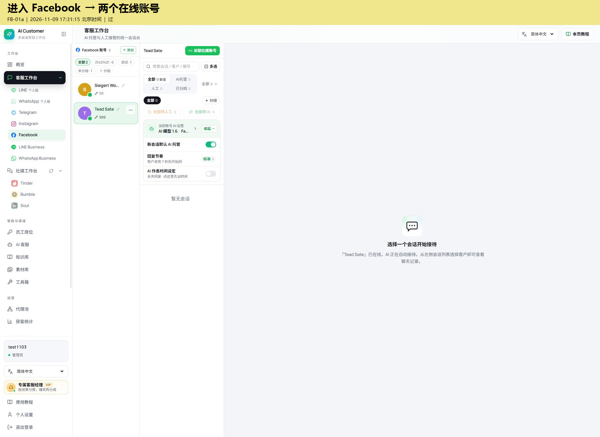
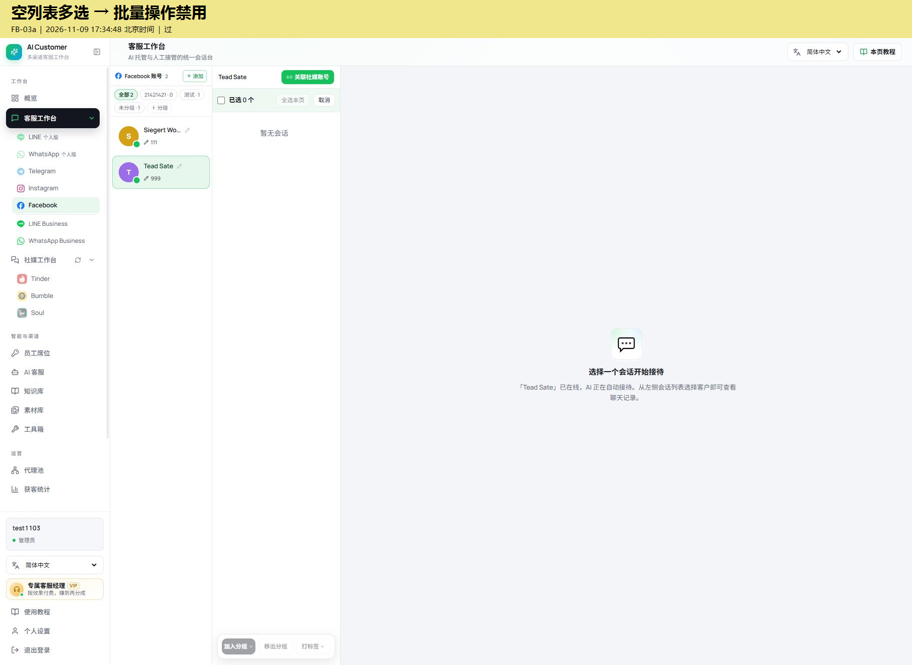
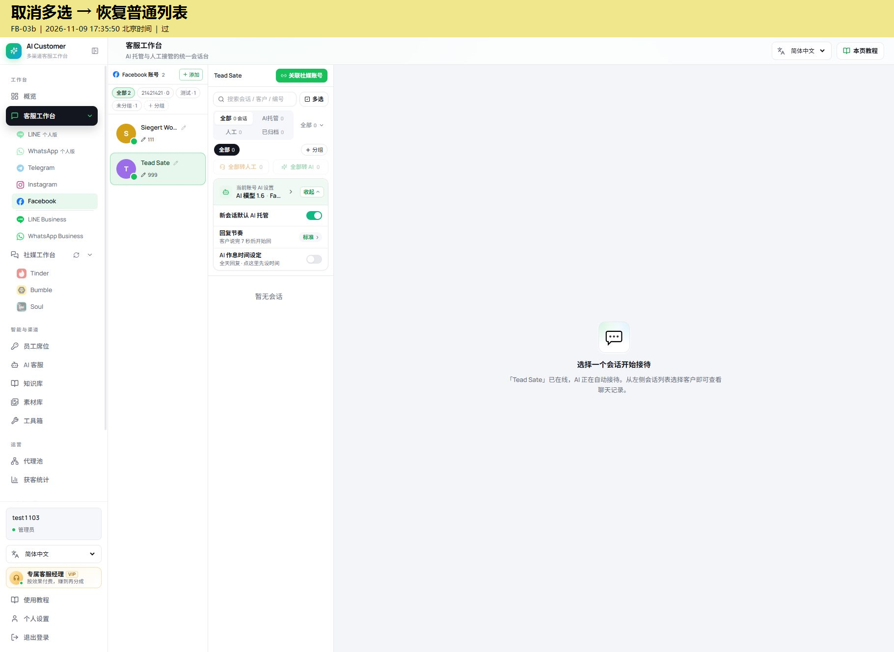
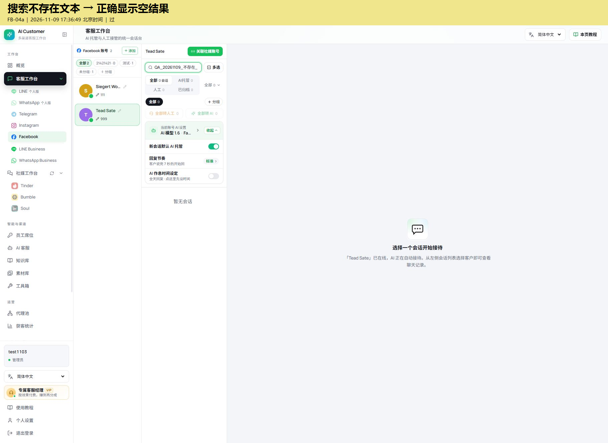
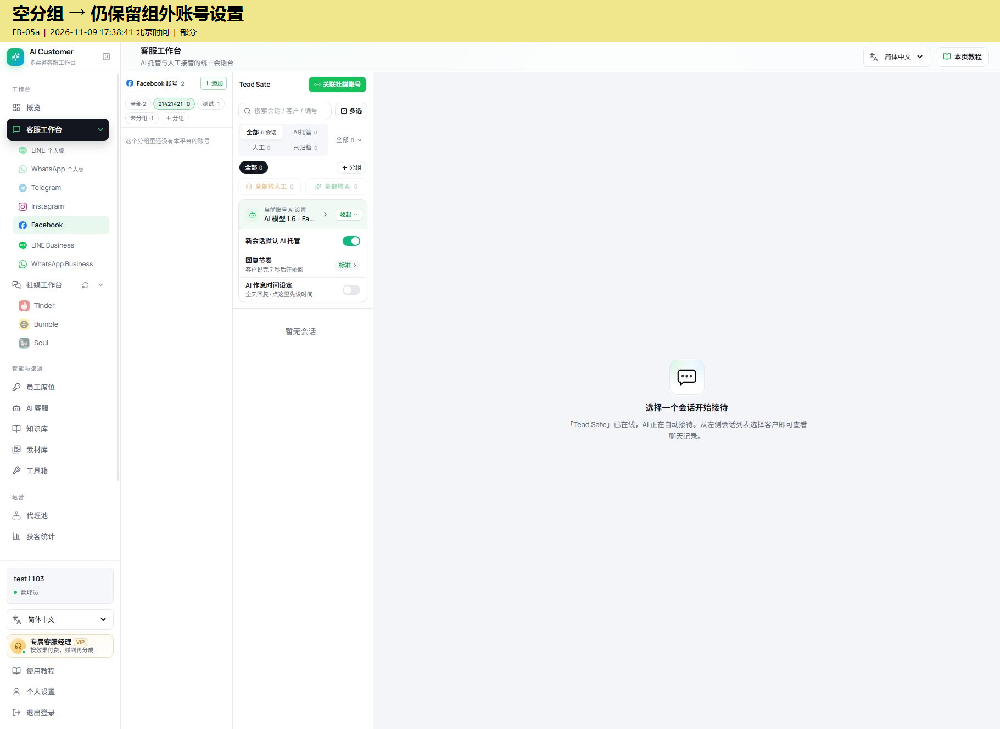
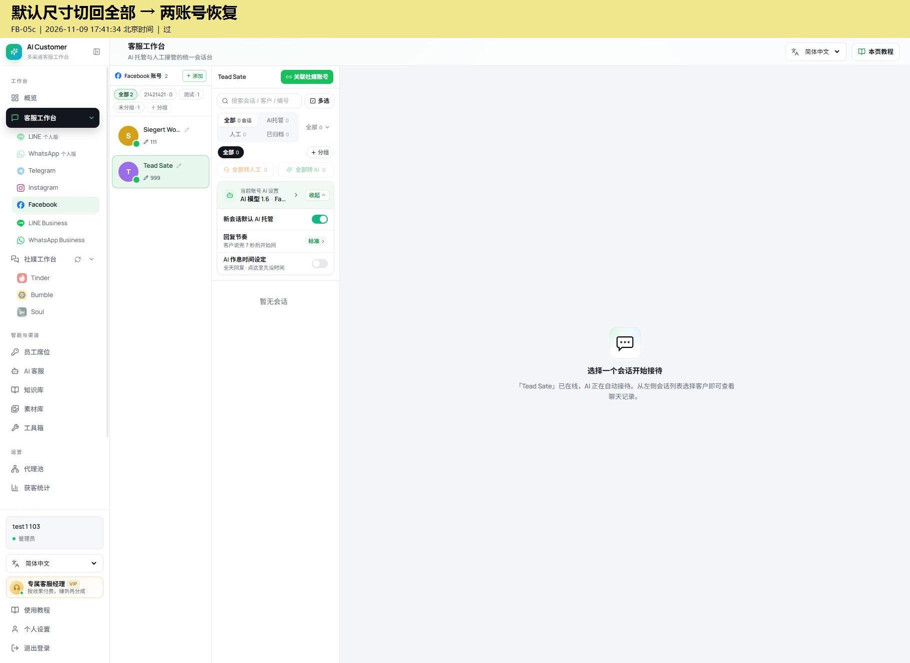
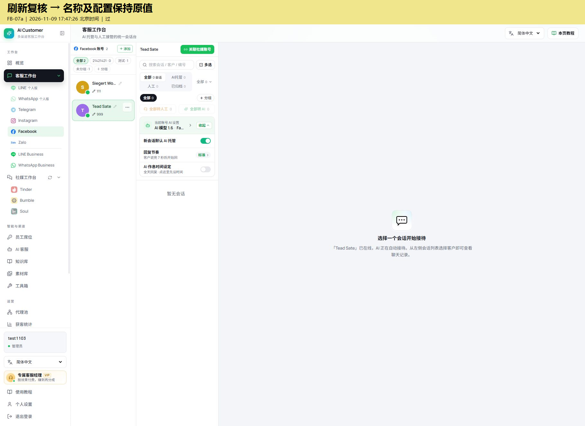

# Facebook 基础功能测试 2026年11月9日

> 部署补记（2026-11-10 16:18，北京时间）：本轮代码已发布至测试环境，产品提交 3459f2e6，工作台入口 index-wUQYEmac.js。会话读取接口检查通过，原双端操作步骤仍待复测。

## 一句话结论

完成 7 项 Facebook 基础测试：6 项过，1 项部分（待确认交互预期），没有确认的阻断 BUG。本轮用于跑通“操作 → 验证 → 截图 → 记录 → 还原 → GitHub 交付”，不代表 Facebook 全功能验收通过。

## 三条总结

- **能用的基础功能**：平台入口、切换空账号、空列表多选与取消、混合语言空搜索、名称编辑 Esc 取消、刷新后原值复核。每项均有本轮截图。
- **待确认 1 项**：空账号分组仍显示组外账号的 AI 设置；只是记录现象，尚未确认为产品 BUG，未修复。
- **范围与回归**：仅 test1103 测试环境，不发送消息，不开启 AI，不重复验证手工表绿色已修复项；未执行双端收发、AI 回复、其他平台功能回归及正式环境复验。

环境：[测试工作台](https://trtest.xiniuzi.com:18447/sessions?channel=facebook)  
测试账号：test1103（管理员）  
主要渠道账号：Tead Sate  
时间：2026-11-09 17:31—17:47，北京时间。截图顶部包含具体取证时间。  
已有覆盖参考：[手工 BUG 表格](https://www.kdocs.cn/l/cedgXxDfHnEK)。已查看可见记录，并按用户说明跳过绿色项；未宣称已读取整份表的全部行。  
截图说明：使用内置浏览器实际截图，只在图像上方新增黄色说明条，原页面区域未修改；原始截图保留在本地。截图实际为 1821 × 1252，未裁去账号上下文。

## 逐条对照表

| 编号 | 要验证的事与预期 | 实际操作与结果 | 结论 | 北京时间 | 账号 | 截图 |
| --- | --- | --- | --- | --- | --- | --- |
| FB-01 | 平台入口显示正确渠道和账号 | 进入 Facebook，显示两个在线账号，Tead Sate 显示暂无会话；零会话批量切换禁用 | 过 | 17:31:15 | test1103 / Tead Sate | FB-01a |
| FB-02 | 切换账号不残留其他账号聊天 | 从已有会话上下文切换到 Tead Sate，列表为空，聊天区显示选择会话提示 | 过 | 17:33:24 | test1103 / Tead Sate | FB-02a |
| FB-03 | 空列表批量操作不可执行，取消恢复 | 点击多选，已选 0 个；全选本页、加入分组、移出分组、打标签禁用；取消恢复普通列表 | 过 | 17:34:48、17:35:50 | test1103 / Tead Sate | FB-03a、FB-03b |
| FB-04 | 混合字符空搜索不破坏页面 | 输入 QA_20261109_不存在_越南语Đặng_🙂，仍为零会话且界面可用；随后清空 | 过 | 17:36:49 | test1103 / Tead Sate | FB-04a |
| FB-05 | 空分组与账号上下文保持一致 | 选择 21421421 · 0，左侧提示无账号，右侧仍显示 Tead Sate 及其 AI 设置；切回全部后恢复两账号 | 部分 | 17:38:41、17:41:34 | test1103 / Tead Sate | FB-05a、FB-05c |
| FB-06 | Esc 取消名称编辑，不保留临时名称 | 记录原值 Tead Sate；输入 QA-CANCEL-20261109 后按 Esc；名称恢复，刷新后仍为原值 | 过 | 17:42:56、17:44:08 | test1103 / Tead Sate | FB-06a、FB-06b、FB-07a |
| FB-07 | 刷新后身份和原配置保持 | 刷新仍为 test1103；重新选择 Tead Sate，名称、备注、客服绑定、回复节奏和开关均与初始截图一致 | 过 | 17:47:26 | test1103 / Tead Sate | FB-07a |

说明：FB-04 只覆盖空列表输入，不代表有数据时搜索命中或过滤正确。FB-07 不断言刷新会保持当前选中的渠道账号。以上 7 项按功能计数，截图子编号不重复算测试项。

## 测试中发现的问题

### OBS-01 空账号分组仍保留组外账号设置 待确认

> **修复补记（2026-11-10）**：空分组下若会话区仍显示上一个账号，账号栏会明确提示当前上下文，避免把组外账号的 AI 设置误认为该组配置。待部署后复测。

1. test1103 进入 Facebook，选择 Tead Sate。
2. 点击账号分组“21421421 · 0”。
3. 左侧显示“这个分组里还没有本平台的账号”，中栏仍显示 Tead Sate、AI 托管开关及回复节奏设置。

**预期需确认**：切到空分组后，是清空当前账号上下文，还是允许继续操作原账号并提示“当前账号不属于该分组”？

**潜在影响**：使用者可能误以为后续设置作用于当前分组。此次没有修改这些设置，也没有验证会造成错误写入。

**状态**：待确认，不作为已确认 BUG；未修复，无修后截图。证据 FB-05a，退出该状态的证据 FB-05c。建议清空上下文，或明确提示仍在操作组外账号。

### 测试工具记录 不计入产品 BUG

内置浏览器连接曾超时。临时设置 1360 × 900 后的一次“切回全部”点击未生效；恢复默认浏览器尺寸后再次点击成功。由于无法区分控制坐标与页面原因，此次不归因产品。

本轮未取得可靠的“点击至内容稳定 0.7 秒”页面用时数据；工具往返耗时不能当作页面性能。1.5 秒阈值检查留待后续，未给出速度通过结论。

## 等待事项与测试改动还原

- **无需本轮追加操作**：用户已限定先做简单、不发送消息的测试；扫码、消息、AI、权限、多媒体、计费等细化验证留待后续。
- **待产品确认**：OBS-01 推荐清空空分组下的账号上下文；如保留，建议加组外账号提示。
- **已恢复**：搜索清空；多选退出；账号分组返回“全部”；账号名称临时输入按 Esc 取消；浏览器临时尺寸覆盖已撤销。
- **原值复核**：Tead Sate；备注 999；Facebook 默认客服；标准回复节奏，客户说完 7 秒后开始回；新会话默认 AI 为开启；作息为关闭。这些开关是测试前已有状态，本轮没有切换。
- **未操作**：未发送消息、未执行 AI 调用、未删除/新增账号或分组、未保存业务配置。
- **交付自查**：7 项都有截图及文字说明；截图无密码、令牌、二维码或客户聊天内容。本文只含本次重新测试结果。正式环境验收尚未进行。

## 截图证据

### FB-01a 进入 Facebook → 两个在线账号

平台显示两个在线账号；当前账号为空会话列表，全部转人工和全部转 AI 均禁用。

### FB-02a 切换空账号 → 不残留上一会话

从有会话账号切换到 Tead Sate，验证空列表与聊天区清空，不应残留上一个客户内容。

### FB-03a 空列表多选 → 批量操作禁用

已选 0 个；全选本页、加入分组、移出分组、打标签均禁用，取消可用。

### FB-03b 取消多选 → 恢复普通列表

取消后恢复搜索框、筛选标签和 AI 设置区，空列表仍为 0。

### FB-04a 搜索不存在文本 → 正确显示空结果

空账号输入中文、越南语及表情组合，搜索框接受文本，保持零会话且页面正常。仅验证空列表，不代表有数据命中通过。

### FB-05a 空分组 → 仍保留组外账号设置

账号分组 21421421 显示 0 且提示无账号，但中栏仍显示 Tead Sate 及其 AI 设置。需要产品确认筛选是否应清空当前账号，暂列待确认体验问题。

### FB-05c 默认尺寸切回全部 → 两账号恢复

恢复默认浏览器尺寸后重新点击全部，账号分组成功切回并显示两个账号；此前点击未生效不据此归因产品。

### FB-06a 打开账号名称编辑 → 记录原值

原账号显示名 Tead Sate，输入框提示留空使用账号本名。

### FB-06b 编辑名称按 Esc → 恢复原名称

输入 QA-CANCEL-20261109 后按 Esc，编辑关闭，卡片及中栏仍为 Tead Sate，临时名称未留下。

### FB-07a 刷新复核 → 名称及配置保持原值

刷新后仍登录 test1103；重新选择 Tead Sate 后名称、备注 999、Facebook 默认客服、标准 7 秒、新会话 AI 开启及作息关闭与初始截图一致。测试未改变这些开关。

