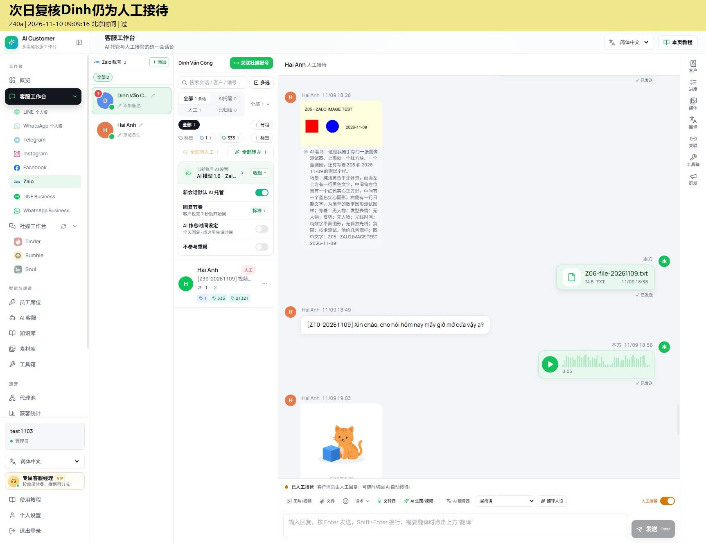
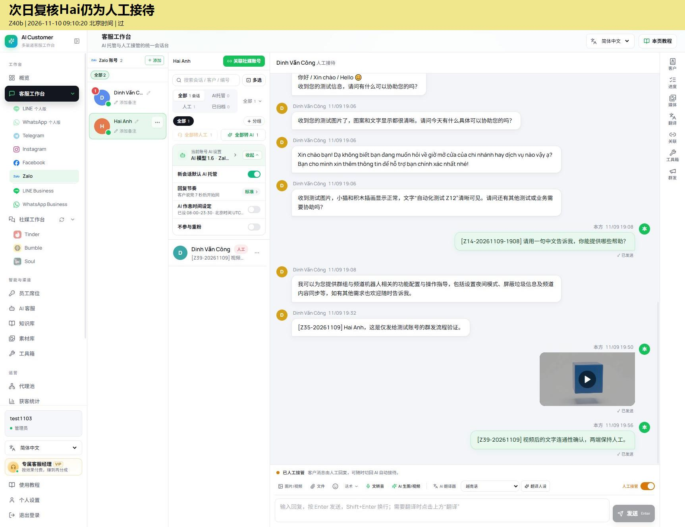

# Zalo 测试记录 · 2026-11-10

- [今日剩余功能补测报告及71张截图](remaining/)：4类待修问题、待测清单与双人工恢复证据。
- 以下为今天早先的昨日测试补充核验。

## Zalo 补充核验 · 2026-11-10

今日仅完成昨日测试的下载校验、恢复状态复核和报告交付，不新增一轮全功能通过结论。

- 发送侧TXT下载与原文件SHA256一致，证明文件存储完整；接收侧缺失仍按昨日双端证据记录。
- 09:09、09:10分别核对Dinh与Hai现有会话均为人工接待；标准7秒，重粉关闭。
- Hai作息已设但未启用，具体残留配置与未测项见完整报告。

[2026-11-09完整报告及问题清单](../../2026-11-09/Zalo/README.md)

